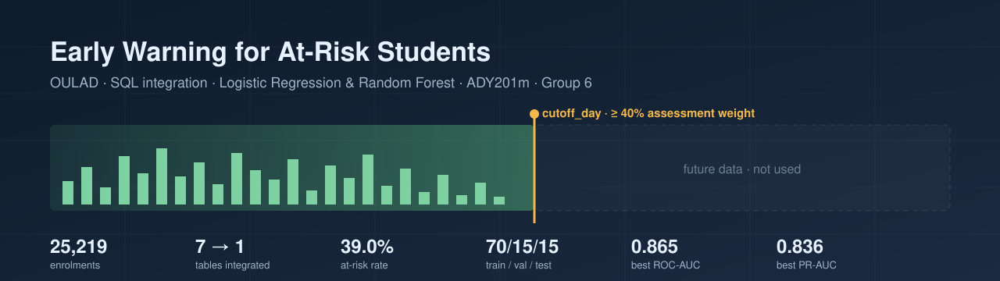
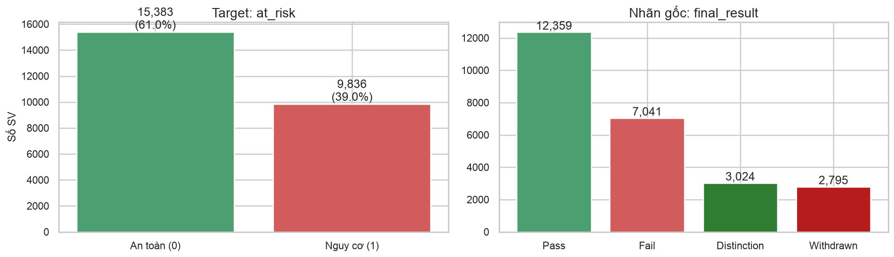
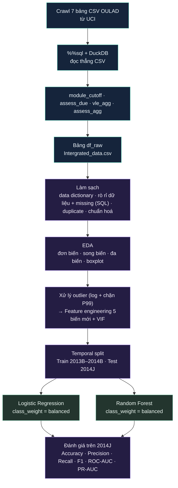
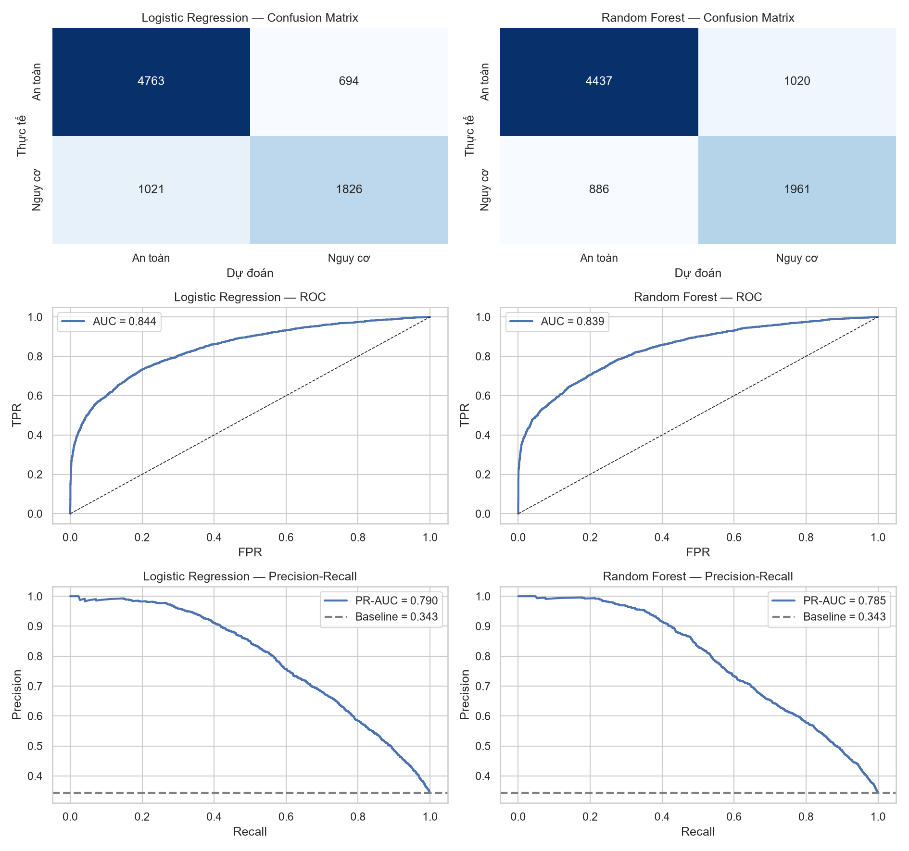
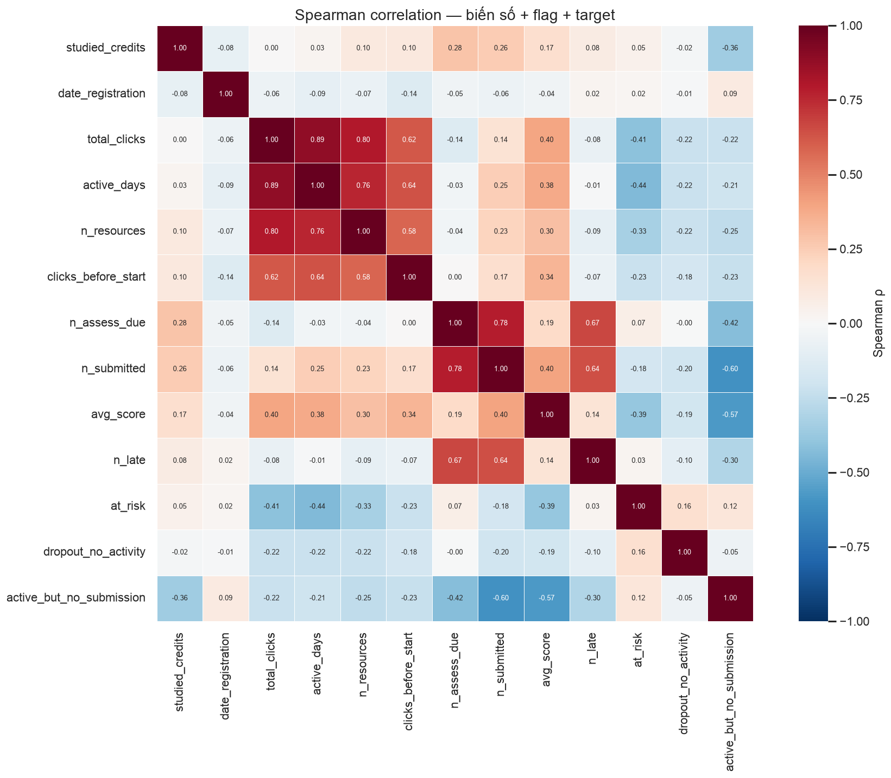
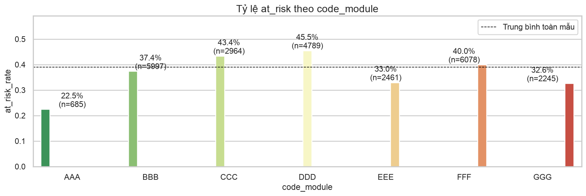

<p align="center">
  
</p>

<h1 align="center">Early Warning for At-Risk Students<br>Dự đoán sớm sinh viên có nguy cơ học lại</h1>

<p align="center">
  Tích hợp 7 bảng OULAD bằng SQL, làm sạch, EDA và hai mô hình phân loại — chỉ dùng dữ liệu có trước mốc cảnh báo.
</p>

<p align="center">
  
  
  
  
</p>

<p align="center">
  <strong>ADY201m</strong> · AI, Data Science with Python &amp; SQL · <strong>AI2102</strong> · <strong>Nhóm 6</strong>
</p>

<p align="center">
  <a href="G6_FINAL.ipynb"><strong>Xem notebook</strong></a> ·
  <a href="integrate.sql">SQL pipeline</a> ·
  <a href="#results">Kết quả</a> ·
  <a href="#quick-start">Chạy lại</a> ·
  <a href="https://archive.ics.uci.edu/dataset/349">Dataset</a>
</p>

---

## 🧭 Câu hỏi nghiên cứu

**Tại thời điểm môn học mới tích luỹ được khoảng 40% trọng số điểm, có thể xác định những sinh viên sẽ trượt (`Fail`) hoặc rút khỏi học phần (`Withdrawn`) hay không?**

Phát hiện sinh viên gặp khó khăn qua điểm giữa kỳ hay cuối kỳ thường là quá muộn. Trong khi đó, hệ thống học trực tuyến (VLE) ghi lại hằng ngày lượt đăng nhập, lượt truy cập tài liệu và lịch nộp bài. Dự án dùng các dấu vết hành vi này, cùng lịch sử học tập và điểm các bài kiểm tra đầu tiên, để lập danh sách cảnh báo sớm. Cố vấn học tập có thể dựa vào đó để ưu tiên hỗ trợ khi vẫn còn khoảng 45% thời lượng học phần.

Hai câu hỏi cốt lõi:

1. Những yếu tố nào quan sát được trước mốc cảnh báo dự báo mạnh nhất việc sinh viên trượt hoặc rút học phần?
2. Với nguồn lực tư vấn có hạn, mô hình cần đạt Recall bao nhiêu và nên chọn ngưỡng dự đoán thế nào?

> **Nguyên tắc "không nhìn tương lai":** mọi đặc trưng chỉ được tính từ dữ liệu xảy ra **trước `cutoff_day`** của từng lớp học phần. Đây là ngày mà tổng trọng số các bài kiểm tra đã đến hạn đạt ≥ 40%.

| Lượt ghi danh sau lọc | Lớp học phần | Bảng gốc | Đặc trưng đưa vào mô hình | Mô hình |
| :---: | :---: | :---: | :---: | :---: |
| **25,219** | **22** | **7** | **15 số + 2 phân loại** | **2** |

## 🗺️ Dữ liệu

Dự án dùng [Open University Learning Analytics Dataset (OULAD)](https://archive.ics.uci.edu/dataset/349) gồm 4 kỳ học: 2013B, 2013J, 2014B và 2014J (B = tháng 2, J = tháng 10).

| Bảng | Số dòng | Nội dung chính |
| --- | ---: | --- |
| `courses` | 22 | Danh sách lớp học phần và độ dài kỳ |
| `assessments` | 206 | Loại bài (TMA/CMA/Exam), ngày đến hạn, trọng số |
| `vle` | 6,364 | Tài nguyên học tập trên VLE |
| `studentInfo` | 32,593 | Thông tin sinh viên và **`final_result`** |
| `studentRegistration` | 32,593 | Ngày đăng ký và ngày huỷ đăng ký |
| `studentAssessment` | 173,912 | Điểm và ngày nộp bài |
| `studentVle` | **10,655,280** | Log click hằng ngày |

### Biến mục tiêu

| `final_result` | `at_risk` | Số dòng | Tỷ lệ |
| --- | :---: | ---: | ---: |
| `Pass`, `Distinction` | **0** — an toàn | 15,383 | 61.0% |
| `Fail`, `Withdrawn` | **1** — có nguy cơ | 9,836 | 39.0% |



### Nhóm đặc trưng

| Nhóm | Biến | Nguồn |
| --- | --- | --- |
| Lịch sử học tập | `is_repeater` | `studentInfo` |
| Hành vi VLE trước cutoff | `log_total_clicks`, `active_days`, `n_resources`, `log_clicks_before_start`, `clicks_per_active_day` | `studentVle` |
| Đánh giá trước cutoff | `n_assess_due`, `n_submitted`, `avg_score`, `n_late`, `n_missed`, `submission_rate`, `late_rate` | `assessments`, `studentAssessment` |
| Cờ hành vi | `dropout_no_activity`, `active_but_no_submission` | Tạo ở bước xử lý missing |
| Ngữ cảnh lớp | `code_module`, `pres_semester` | One-hot encoding |

`studied_credits` và `date_registration` có trong bảng tích hợp nhưng bị loại khỏi mô hình vì EDA cho thấy chúng không phân biệt được nguy cơ.

Các biến nhân khẩu học (giới tính, độ tuổi, vùng, IMD, học vấn, khuyết tật) **được loại có chủ đích** vì lý do công bằng. `date_unregistration` cũng bị loại vì là thông tin xảy ra sau mốc dự đoán.

## ✨ Quy trình phân tích



| Phần | Chương | Nội dung |
| :---: | --- | --- |
| **01** | Business Understanding | Bối cảnh, câu hỏi cốt lõi, định nghĩa target và mốc dự đoán. |
| **02** | Thu thập dữ liệu | Nguồn dữ liệu, crawl 7 bảng CSV từ UCI, tích hợp bằng magic `%%sql` (DuckDB) thành một bảng phân tích (1 dòng = 1 sinh viên × 1 lớp học phần) và export CSV. |
| **03** | Làm sạch &amp; tiền xử lý | Data dictionary, xử lý rò rỉ dữ liệu và missing theo nguyên nhân bằng `%%sql`, xử lý duplicate, chuẩn hoá kiểu dữ liệu. |
| **04** | EDA &amp; Feature Engineering | Phân tích đơn biến, song biến, đa biến (Spearman), boxplot, xử lý outlier bằng log và chặn P99 (làm sạch lần 2), tạo 5 biến mới + VIF. |
| **05** | Mô hình &amp; đánh giá | Chia theo thời gian, pipeline `ColumnTransformer`, so sánh Logistic Regression và Random Forest. |

**Train:** 16,915 dòng (3 kỳ đầu, at_risk 41.3%) · **Test:** 8,304 dòng (kỳ 2014J, at_risk 34.3%) · **Seed:** `42`

### Điểm đáng chú ý trong pipeline

- **Cutoff động theo từng lớp.** Mốc 40% rơi vào ngày 68 ở module EEE nhưng ngày 222 ở GGG. Một ngày cố định sẽ không công bằng giữa các môn.
- **`LEFT JOIN` để giữ sinh viên không hoạt động.** Sinh viên không click hay nộp bài nào trước cutoff là nhóm nguy cơ cao nhất. `INNER JOIN` sẽ xoá họ khỏi mẫu.
- **Xử lý rò rỉ dữ liệu ở bước làm sạch (SQL).** Bỏ `date_unregistration`, loại sinh viên đã rút trước cutoff (đã rút thì không còn can thiệp được, giữ lại sẽ tạo nhãn hiển nhiên) và sinh viên đăng ký sau cutoff.
- **Missing có nghĩa.** `avg_score` chỉ thiếu khi chưa nộp bài. Dữ liệu được tách thành 2 cờ: `dropout_no_activity` (at_risk 99.3%) và `active_but_no_submission` (53.7%).
- **Chia theo thời gian thay vì ngẫu nhiên.** Mô hình học từ các kỳ trước và được kiểm tra trên kỳ sau, đúng như khi triển khai thực tế.

<a id="results"></a>

## 📊 Kết quả

### Đánh giá trên tập test 2014J (ngưỡng 0.5)

| Mô hình | Accuracy | Precision | Recall | F1 | ROC-AUC | PR-AUC |
| --- | ---: | ---: | ---: | ---: | ---: | ---: |
| **Logistic Regression** | **79.35%** | **0.7246** | 0.6414 | **0.6805** | **0.8442** | **0.7895** |
| Random Forest | 77.05% | 0.6578 | **0.6888** | 0.6730 | 0.8392 | 0.7847 |

Precision, Recall và F1 tính cho lớp **`at_risk = 1`**. PR-AUC của mô hình nền (đoán ngẫu nhiên) bằng tỷ lệ nguy cơ trên tập test, tức **0.343**.

| Mô hình | TN | FP | FN | TP |
| --- | ---: | ---: | ---: | ---: |
| Logistic Regression | 4,763 | 694 | 1,021 | 1,826 |
| Random Forest | 4,437 | 1,020 | **886** | **1,961** |

Hai mô hình có ROC-AUC và PR-AUC gần như ngang nhau. Random Forest bỏ sót ít sinh viên nguy cơ hơn (FN 886 so với 1,021), nhưng đổi lại có nhiều cảnh báo nhầm hơn. Nhóm chọn **Random Forest** làm mô hình chính vì Recall cao hơn, và dùng **Logistic Regression** để kiểm tra chéo và diễn giải qua hệ số. Hạ ngưỡng của Random Forest xuống 0.4 cho Recall 0.79 (Precision 0.59).



### Biến nào phân biệt được nguy cơ?

| Biến | Median an toàn | Median nguy cơ | Spearman ρ với `at_risk` |
| --- | ---: | ---: | ---: |
| `active_days` | 41 | 19 | −0.438 |
| `total_clicks` | 716 | 290 | −0.411 |
| `avg_score` | 80.7 | 64.0 | −0.385 |
| `n_resources` | 48 | 29 | −0.328 |
| `clicks_before_start` | 41 | 14 | −0.225 |

Mức độ tương tác trên VLE và điểm các bài đã làm là hai nhóm tín hiệu mạnh nhất. Các biến đăng ký (`date_registration`, `studied_credits`) gần như không tách được hai nhóm.



Tỷ lệ nguy cơ cũng khác nhau rõ giữa các môn, từ 22.5% (AAA) đến 45.5% (DDD). Vì vậy `code_module` được đưa vào mô hình làm biến điều khiển.



<a id="quick-start"></a>

## ⚙️ Chạy lại dự án

Dùng **Python 3.11+** (notebook được chạy với Python 3.13).

### 1. Lấy mã nguồn

```powershell
git clone https://github.com/NguyenAnh1421/Early-Warning-At-Risk-Students-OULAD.git
cd Early-Warning-At-Risk-Students-OULAD
```

### 2. Tạo môi trường

```powershell
python -m venv .venv
.\.venv\Scripts\python.exe -m pip install -r requirements.txt jupyterlab
```

### 3. Chuẩn bị dữ liệu

Dữ liệu của từng giai đoạn đã có sẵn trong thư mục [`data/`](data):

| Thư mục | Giai đoạn | Nội dung |
| --- | --- | --- |
| [`data/raw/`](data/raw) | Dữ liệu gốc | 7 bảng CSV OULAD + `OULAD.names`. `studentVle.csv` (433 MB) vượt giới hạn 100 MB của GitHub nên được nén thành `studentVle.csv.gz` (41 MB); pandas đọc trực tiếp được, hoặc giải nén bằng `gzip -dk data/raw/studentVle.csv.gz`. |
| [`data/integrated/`](data/integrated) | Sau tích hợp SQL | `Intergrated_data.csv` (32,593 × 18), export từ bảng SQL `df_raw`; `data_dictionary.csv`. |
| [`data/cleaned/`](data/cleaned) | Sau làm sạch | `cleaned_dataset.csv`, output phần 3 của notebook. |
| [`data/eda/`](data/eda) | Sau EDA & feature engineering | `features.csv`, output phần 4 của notebook. |

Notebook đọc/ghi trực tiếp các file trong `data/`. Phần 2.2 tự tải file zip OULAD từ UCI nếu `data/raw/` chưa đủ 7 file CSV (`studentVle.csv` không có trong repo nên lần chạy đầu sẽ tải khoảng 47 MB). DuckDB đọc thẳng CSV nên không cần tạo database.

### 4. Chạy notebook

```powershell
.\.venv\Scripts\python.exe -m jupyterlab G6_FINAL.ipynb
```

Chọn kernel `.venv`, restart rồi chạy từ trên xuống. Notebook sẽ tự sinh `Intergrated_data.csv`, `data_dictionary.csv`, `cleaned_dataset.csv` và `features.csv`.

## 📂 Cấu trúc repo

```text
.
├── G6_FINAL.ipynb
├── integrate.sql
├── README.md
├── requirements.txt
├── .gitignore
├── data/
│   ├── raw/          # 7 bảng OULAD gốc (studentVle nén .gz)
│   ├── integrated/   # Intergrated_data.csv, data_dictionary.csv
│   ├── cleaned/      # cleaned_dataset.csv
│   └── eda/          # features.csv
└── assets/
    └── readme/
        ├── banner.svg
        ├── target-distribution.png
        ├── correlation-heatmap.png
        ├── risk-by-module.png
        └── model-evaluation.png
```

| File | Vai trò |
| --- | --- |
| [G6_FINAL.ipynb](G6_FINAL.ipynb) | Báo cáo cuối kỳ đầy đủ 5 phần, đã lưu sẵn output. |
| [integrate.sql](integrate.sql) | Bản SQL độc lập của phần 2.3 (DuckDB), tích hợp các bảng OULAD thành `df_raw`, chỉ dùng dữ liệu trước cutoff. |
| [requirements.txt](requirements.txt) | NumPy, pandas, Matplotlib, seaborn, scikit-learn, DuckDB, jupysql. |

## 🔭 Hạn chế &amp; hướng phát triển

- Dữ liệu chỉ có 4 kỳ học nên chưa thể bắt được xu hướng dài hạn.
- Xác suất `predict_proba` chưa được hiệu chuẩn (calibration) nên chưa dùng trực tiếp làm "xác suất rủi ro" được.
- Chưa có kiểm tra công bằng theo nhóm sinh viên (fairness audit).
- Vẫn còn đa cộng tuyến giữa một số cặp biến (`n_late`, `submission_rate`, `active_but_no_submission` có VIF > 10). Điều này ảnh hưởng tới việc diễn giải hệ số của Logistic Regression.
- Siêu tham số đang để mặc định. Có thể thử tinh chỉnh bằng cross-validation chia theo kỳ, và tối ưu ngưỡng theo năng lực tư vấn thực tế.
- Capping P99 đang được tính trên toàn bộ dữ liệu trước khi chia train/test. Đưa bước này vào pipeline sẽ tách tiền xử lý chặt chẽ hơn.

## 👥 Thành viên

| Thành viên | MSSV |
| --- | --- |
| Hoàng Văn Đức | HE210214 |
| Phạm Huy Vũ | HE210285 |
| Nguyễn Tuấn Anh | HE210230 |
| Nguyễn Đình An | HE210153 |

## 📜 Nguồn dữ liệu

Kuzilek, J., Hlosta, M., &amp; Zdrahal, Z. (2017). Open University Learning Analytics dataset. *Scientific Data*, 4, 170171. [DOI: 10.1038/sdata.2017.171](https://doi.org/10.1038/sdata.2017.171)

Dataset có trên [UCI Machine Learning Repository](https://archive.ics.uci.edu/dataset/349) ([DOI: 10.24432/C5KK69](https://doi.org/10.24432/C5KK69)) theo giấy phép [CC BY 4.0](https://creativecommons.org/licenses/by/4.0/).

---

<p align="center"><strong>ADY201m · AI2102 · Nhóm 6</strong><br>Cảnh báo sớm — khi vẫn còn kịp để giúp.</p>
